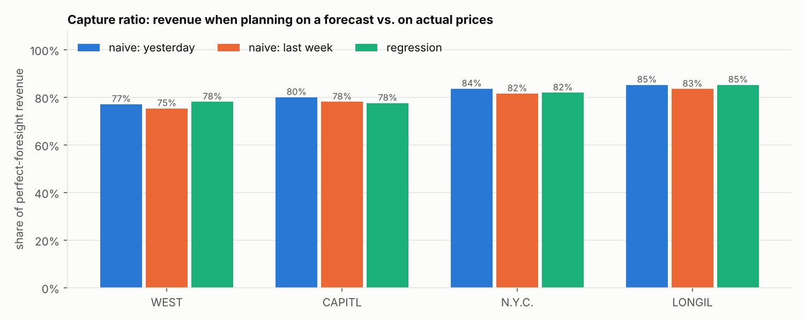
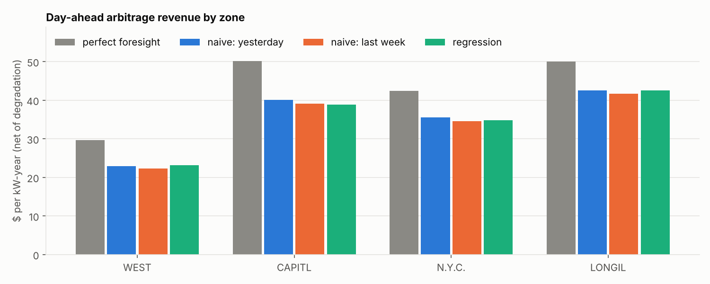
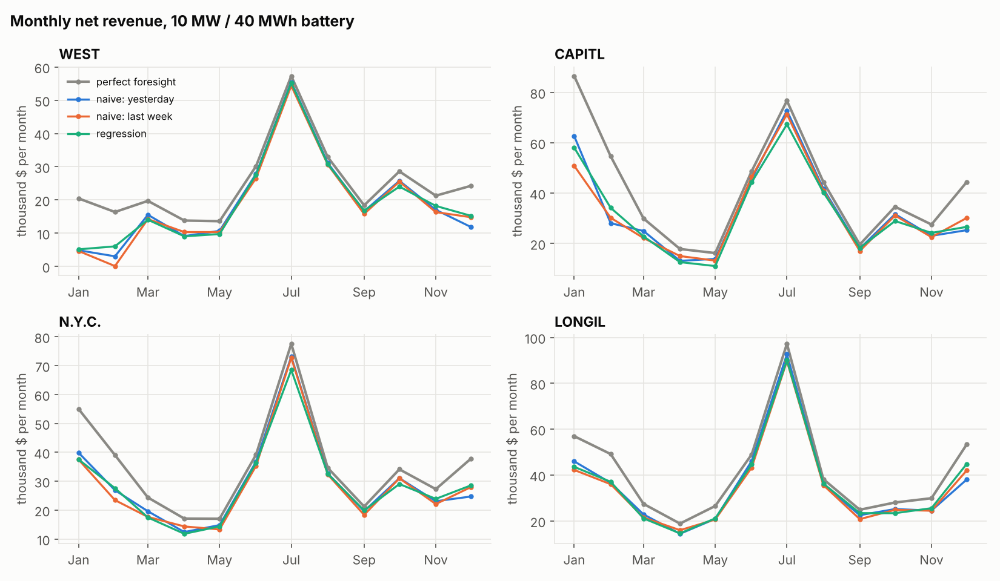
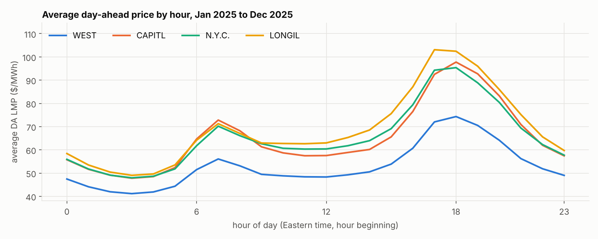
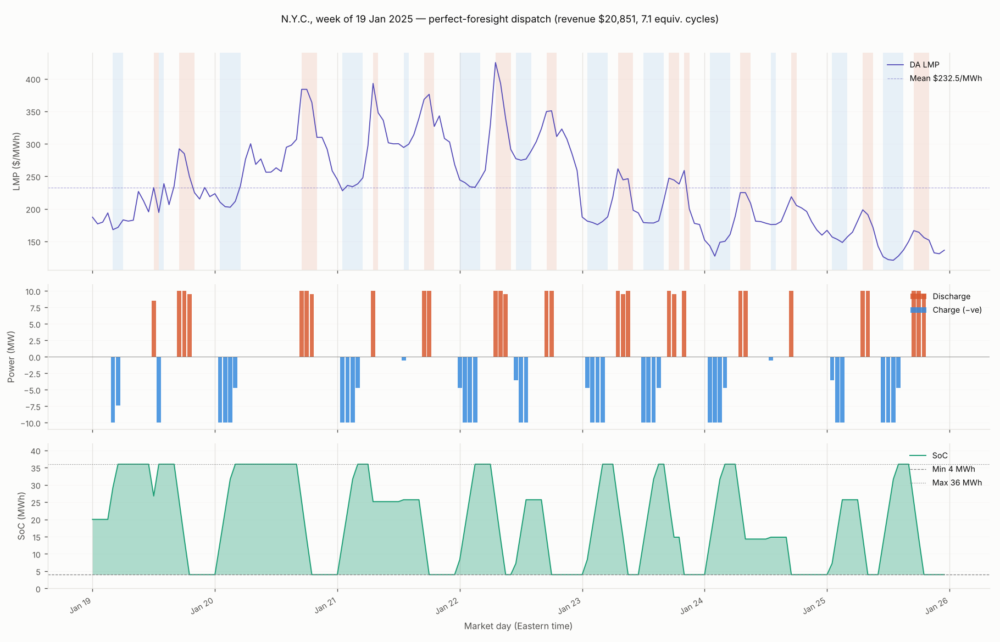

# BESS Dispatch Optimizer

How much can a battery earn from day-ahead energy arbitrage in New York, and how much of that does it keep when it has to plan on a price forecast instead of knowing the prices?

This project pulls real NYISO day-ahead prices, optimizes battery dispatch with a linear program, and backtests forecast-driven dispatch against perfect foresight for four NYISO zones in 2025.

## Results (2025, 10 MW / 40 MWh battery)

| Zone | Perfect foresight ($/kW-year) | Capture: yesterday's prices | Capture: last week's prices | Capture: regression |
|---|---:|---:|---:|---:|
| WEST | 29.7 | 77% | 75% | 78% |
| CAPITL | 50.1 | 80% | 78% | 78% |
| N.Y.C. | 42.4 | 84% | 82% | 82% |
| LONGIL | 50.0 | 85% | 83% | 85% |

Revenue is day-ahead energy arbitrage only, net of a $3/MWh degradation cost. Capture ratio = revenue when planning on the forecast and settling at actual prices, divided by perfect-foresight revenue. Full table with forecast error metrics: [`results/summary.md`](results/summary.md).

**What stands out**

- **Simple forecasts keep 75-85% of the perfect-foresight revenue.** A battery mostly needs to know *which* hours are cheap and which are expensive, and the daily shape is fairly stable.
- **CAPITL, N.Y.C. and LONGIL earn far more than WEST**, because their evening peaks are higher (see the price-shape chart below).
- **A better error metric does not mean much more revenue.** Last week's prices have about twice the forecast error (MAE) of yesterday's prices, but capture only about 2 percentage points less.
- **A regression on past prices alone does not beat "same as yesterday"** in most zones. Without load, weather, gas or outage forecasts there is little to add to persistence.
- **Revenue and misses are concentrated.** The best 10% of days bring in about a third of the annual perfect-foresight revenue, and 43-57% of the revenue the yesterday-forecast misses is lost on just 10% of days, mostly in winter (December to February). Those days are where a better forecast would pay off.









A week of perfect-foresight dispatch in New York City during the January 2025 cold snap:



## How it works

1. **Data** (`data_fetch.py`): downloads NYISO day-ahead zonal LBMPs (dataset P-2A) from the public MIS portal, one ZIP per month, and caches them in SQLite. Timestamps are stored in UTC; days are NYISO market days (Eastern time), so DST days have 23 or 25 hours.
2. **Optimizer** (`optimizer.py`): a linear program in PuLP (CBC solver), solved one market day at a time with the state of charge carried over.
   - Variables per hour: charge `c`, discharge `d`, state of charge `e`
   - Objective: maximize Σ price × (d − c) − degradation cost × d
   - Energy balance: `e[t] = e[t-1] + √η·c[t] − d[t]/√η` (η = round-trip efficiency)
   - Limits: `0 ≤ c, d ≤ P`, `c + d ≤ P`, `E_min ≤ e ≤ E_max`

   The LP can plan on any price column (`plan_col`) while revenue is always settled at the actual price. That is what makes the forecast backtest possible.
3. **Backtest** (`backtest.py`): for each market day, plan on a forecast made only from prices known before the day-ahead market closes, then settle at actual prices.
   - `naive_d1`: same hour yesterday
   - `naive_d7`: same hour last week
   - `regression`: ridge regression refit every day on the last 90 days (hour-of-day and weekend dummies, 24h/48h/168h lags, yesterday's average price)

   A test checks that changing day D's prices does not change the forecast for day D (no look-ahead).
4. **Reporting** (`reporting.py`, `charts.py`): dispatch dashboards and the result charts above.

**Battery assumptions:** 10 MW / 40 MWh (4 hours), 85% round-trip efficiency, state of charge kept between 10% and 90%, $3/MWh degradation cost, starting at 50%.

## Limitations

- **Day-ahead energy only.** No real-time market, ancillary services (reserves, regulation) or capacity payments, which are a large share of real battery revenue in NYISO.
- **Zonal prices**, not the nodal price at a specific site.
- **Price taker.** The battery's own bids do not move prices.
- **Self-scheduled.** A real battery bids price-quantity curves into the market. Here the schedule is fixed from the forecast.
- **Each day is optimized on its own**, so energy left at midnight has no value and the battery tends to end the day near its minimum charge.
- **Simple degradation** (a flat $/MWh), no cycle limits or warranty constraints.
- **Forecasts use past prices only.** A real forecast would add load, weather, gas prices and outages.
- **One year** of results (2025).

## Quickstart

```bash
git clone https://github.com/aselzner/bess-optimizer.git
cd bess-optimizer
python -m venv .venv
source .venv/bin/activate          # Windows: .venv\Scripts\activate
pip install -r requirements.txt

# 1. Download NYISO day-ahead prices (about 24 monthly files, a minute or two)
python data_fetch.py --start 2024-01-01 --end 2025-12-31 \
    --nodes WEST CAPITL N.Y.C. LONGIL --db data/nyiso_dam.db

# 2. Run the backtest and write results/ (about a minute)
python backtest.py --db data/nyiso_dam.db --start 2025-01-01 --end 2025-12-31

# 3. Run the tests (offline, no NYISO access needed)
python -m pytest
```

Without internet access, `python data_fetch.py --start 2025-01-01 --end 2025-01-14 --mock` writes synthetic prices, and the notebooks `01`-`03` walk through each module on that mock data.

## Project structure

| File | What it does |
|---|---|
| `data_fetch.py` | Download and cache NYISO day-ahead zonal LBMPs; mock data generator |
| `optimizer.py` | Battery config, LP dispatch (single horizon and rolling daily) |
| `backtest.py` | Forecasts, forecast vs perfect-foresight backtest, summary tables |
| `charts.py` | Result charts for this README |
| `reporting.py` | Dispatch and P&L dashboard figures |
| `tests/` | Offline tests for data parsing, the LP and the backtest |
| `results/` | 2025 backtest output (tables and charts) |
| `01`-`03_*.ipynb` | Step-by-step notebooks on mock data |

## Next steps

- Add real-time prices and the DA/RT spread
- Co-optimize energy with NYISO reserves and regulation
- Add load and weather forecasts to the price forecast, and probabilistic (quantile) forecasts
- Value end-of-day state of charge instead of solving each day in isolation
- Model bidding as price-quantity curves rather than a fixed schedule
